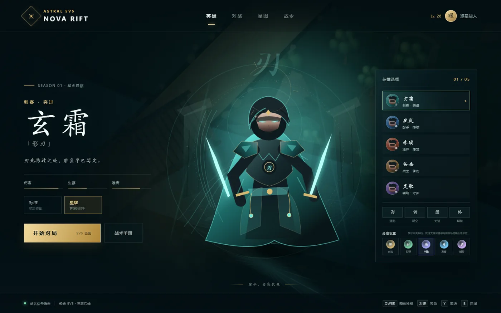
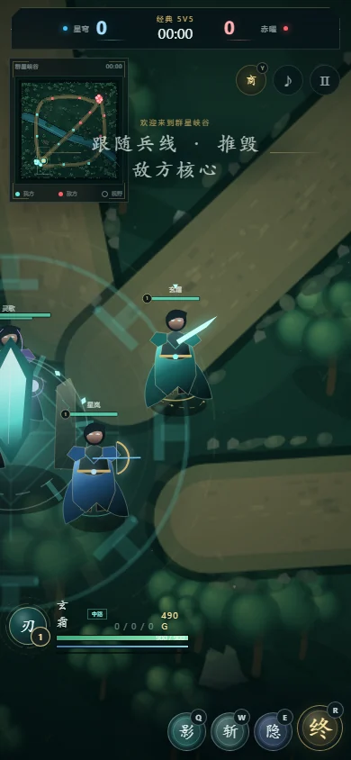

# Nova Rift

### A star-lit 5v5 MOBA that runs directly in your browser.

Nova Rift（星渊裂隙）是一款无需安装、无需后端的 5v5 英雄竞技游戏原型。战场、英雄、技能特效、UI 与程序化音效均由 Canvas、CSS 和原生 JavaScript 构建。

<p align="center">
  
  
</p>

## Highlights

- A complete single-player 5v5 match: one player plus four AI allies against five AI opponents.
- Five heroes with distinct stats, passives, four abilities, roles, and visual identities.
- Three lanes, jungle camps, defensive towers, river objectives, and a timed boss.
- Role-aware AI for top, jungle, mid, bottom, and support positions.
- Twelve purchasable items, six equipment slots, and live stat bonuses for both teams.
- Responsive desktop and mobile HUD with a touch joystick.
- Procedural Web Audio effects with an in-game mute control.
- No runtime dependencies, build step, framework, or backend.

## Run locally

Node.js 20 or newer is recommended.

```powershell
npm install
npm start
```

Open <http://127.0.0.1:8000>. You can also open `index.html` directly, although the local server is recommended for testing.

To use another port:

```powershell
$env:PORT = 4173
npm start
```

## Controls

| Input | Action |
| --- | --- |
| Right click | Move / path toward a point |
| Left click | Select and attack an enemy |
| `Q` / `W` / `E` / `R` | Cast an ability toward the cursor |
| `Space` | Attack the nearest enemy |
| Arrow keys | Keyboard movement |
| `B` | Recall to base |
| `Y` | Open or close the shop |
| `Tab` | Toggle the scoreboard |
| `Esc` | Pause or close the active panel |
| `M` | Toggle sound |

On mobile, drag in the lower-left region to move and tap enemies or ability buttons to act.

## Engineering notes

Nova Rift intentionally stays close to the platform:

- The world, heroes, and effects use layered Canvas 2D rendering.
- The lobby backdrop is cached and refreshed at a lower cadence instead of being redrawn every frame.
- Hero portrait rendering is frame-limited, while live combat remains smooth.
- The animation loop pauses when the page is hidden and reacts to reduced-motion preferences.
- DOM references used by the HUD are cached outside the combat update loop.
- A dependency-free Node server provides predictable local development behavior on Windows, macOS, and Linux.
- Playwright covers combat input, hero selection, role assignment, shopping, objectives, victory flow, and mobile layout.

## Project structure

```text
index.html                  Game shell and HUD markup
styles.css                  Lobby, battlefield HUD, and responsive layouts
js/data.js                  Heroes, abilities, items, roles, and map data
js/game.js                  Simulation, AI, rendering, input, and match flow
scripts/serve.mjs           Zero-dependency local static server
tests/smoke.spec.js         End-to-end Playwright coverage
docs/screenshots/           Optimized WebP project previews
```

## Testing

```powershell
npm install
npx playwright install chromium
npm test
```

The Playwright configuration starts the site automatically and retries once in CI. Screenshots are only generated when `CAPTURE_SCREENSHOTS=1` is set.

```powershell
$env:CAPTURE_SCREENSHOTS = "1"
npm test
```

Generated test assets are written under `test-results/` and are excluded from version control.

## Browser support

Nova Rift targets current versions of Chrome, Edge, Firefox, and Safari. Touch controls and pointer input require a modern browser; Web Audio remains optional if the browser blocks autoplay.
